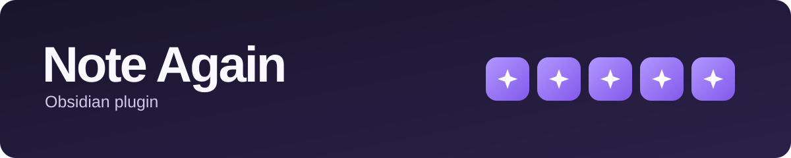
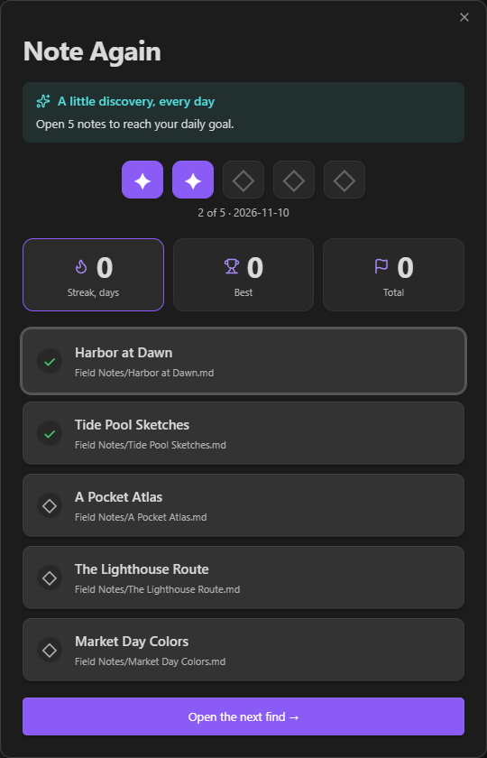

Note Again is an Obsidian plugin that helps you revisit your notes, refresh your memory, and connect ideas through a daily quest.

Every day, Note Again shows you a random selection of notes. You can set how many notes (5 by default) to revisit and filter which ones are picked.
Reach your goal to complete the daily quest.
Complete quest every day to build a streak.



## Features

- Each selected note counts once, even when opened through search or a link.
- See your current streak, longest streak, and total completed quests.
- Move between selected notes with **Previous** and **Next**, or return to the quest with **Back to Note Again**.
- Open the quest from the ribbon or use the command palette to show the quest or open the next unread note.

## Settings

Configure your quest in **Settings → Note Again**.

- Set your daily note goal. Changes apply to the next quest.
- Pick a source folder and its subfolders, or use the whole vault.
- Exclude files, folders, or tags. Folder and tag exclusions include subfolders and nested tags. Changing filters keeps your progress.
- Turn in-app reminders on or off, set an interval of 15–240 minutes, or preview a reminder. You can snooze a reminder for an hour.

## Installation

Requires Obsidian 1.15.0 or later.

### Obsidian Community

Once listed, install and enable [Note Again from Obsidian Community](https://community.obsidian.md/plugins/note-again).

### Manual installation

1. Once a release is available, download `main.js`, `manifest.json`, and `styles.css` from [Note Again Releases](https://github.com/wert-rar/note-again/releases).
2. Create a `note-again` folder inside your vault’s `.obsidian/plugins/` directory and copy the three files into it.
3. Restart Obsidian and enable **Note Again** under **Settings → Community plugins**.

When updating manually, keep `data.json` to preserve your settings and progress.

## Development

Requires Node.js 24 or later.

```sh
npm ci
npm run check
npm run build
npm test
```

For a local build, use the three files from `dist/note-again/` in the manual installation steps.

## License

Note Again is licensed under the [MIT License](LICENSE).
